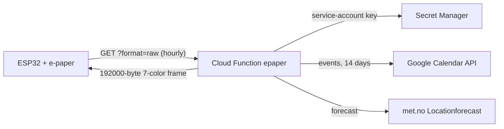

# kitchen-epaper-renderer

Renders the family's kitchen board ("Kjøkkentavla") for a Waveshare 7.3" 7-color e-paper display (800×480).
It runs as a Google Cloud Function and shows, in a hand-drawn style:
- **Today's date** with icons for today's all-day events and holidays, and the current weather
- **Agenda** from a Google Calendar: ongoing multi-day events, today, tomorrow and up to 3 later days,
  with family members shown as coloured rings
- **Weather** for Kjelsås, Oslo (from met.no) at 08, 12, 16 and 20 — for today, or for tomorrow from 16:00
- **Season field:** countdown to the next holiday and a seasonal scene, or balloons on someone's birthday

---

## How it fits together



1. The ESP32 (firmware in `../kitchen-epaper-esp32` and `../kitchen-epaper-display`) calls the function about once an hour.
2. `get_events()` reads the service-account key from Secret Manager and fetches 14 days of events.
3. `get_weather()` fetches the hourly forecast for `YR_LAT`/`YR_LON`.
4. `render_image()` draws the board as a PNG that contains only the 7 panel colors.
5. For `?format=raw` the image is rotated 180° (the panel hangs upside down) and packed 2 pixels per byte.

If the function fails, the display keeps showing its previous image.

---

## Project layout

| Path | Contents |
|---|---|
| `main.py` | Entry point `epaper()`, fetching, parsing of event titles, layout, raw encoder |
| `sketch.py` | Hand-drawn drawing primitives, fonts, the 7-color palette, weather icons |
| `seasonal.py` | Holidays, countdowns, seasonal themes and scenes, birthday scene |
| `tests/test_epaper.py` | End-to-end and layout tests (only the outside services are faked) |
| `deploy.sh` | Tests, deploy and smoke test; holds the deployed environment variables |
| `design/` | Design spec `DESIGN-kjokkentavle.md` (v8, Norwegian), browser prototype, reference renders |
| `fonts/` | Kalam (handwritten font, SIL OFL) |

Not used by the current code: `icons/`, `fonts/Roboto-Regular.ttf`, `convert_svg_to_png.py`, `fetch_missing_icons.py`
and `copilot-instructions.md` (left from the first design, before everything was drawn by hand).

---

## Configuration

The function reads four environment variables. They are set in `deploy.sh`:

| Variable | Meaning | Current value |
|---|---|---|
| `CALENDAR_ID` | Google Calendar to show | the family calendar |
| `YR_LAT`, `YR_LON` | Weather location | `59.97`, `10.78` (Kjelsås) |
| `SECRET_NAME` | Secret Manager secret with the service-account JSON key | `projects/14548432634/secrets/kitchen-epaper-renderer-google-calendar-secret` |

To move the weather location, change `YR_LAT`/`YR_LON` in `deploy.sh` and deploy.
Check what the live function uses:

```bash
gcloud functions describe epaper --gen2 --region=europe-north1 --format="yaml(serviceConfig.environmentVariables,updateTime)"
```

### Calendar conventions
- A prefix with initials becomes coloured rings: `S: Piano`, `K&R&E: Høsttreff`, `R og S: Tusenfryd`, `Alle: Middag`.
  First names in the title work too (`Fotballtrening Emilie`). People and colours are in `PEOPLE` and `NAMES` in `main.py`.
- All-day events become an icon instead of a row: søppel/avfall → bin, tannlege → tooth, fly/reise → plane, otherwise a star (`EVENT_ICONS`).
- All-day events with "bursdag" in the title and no person prefix are birthdays: balloons and the name in the season field on the day.

---

## Rendering rules

Full spec: `design/DESIGN-kjokkentavle.md`; reference renders: `design/kjokkentavle-v8-*.png`. The code wins if they disagree.
- Only the 7 exact panel colors are used, no dithering, so the PNG preview matches the panel.
- Everything is drawn at 2× on an ink layer (black, thresholded) and a colour layer (flat palette fills), then flattened.
- All text is at least 22 px so it can be read from across the kitchen.
- The wobble of the lines is seeded with the date: the same data on the same day gives an identical image (no ghosting).
- Today and tomorrow are always shown in full. When space runs out, rows get tighter, then tomorrow and today are listed
  comma-separated, and later days are dropped (a day is shown with all its events or not at all).

---

## Developing

### Run the tests

```bash
python -m unittest discover -s tests -v
```

`deploy.sh` creates `.venv` with `requirements.txt` the first time; `.venv/bin/python` works as the interpreter.

### Preview a render without network

`render_image(events, weather)` takes plain data, so you can render any situation locally:

```bash
CALENDAR_ID=x YR_LAT=59.97 YR_LON=10.78 SECRET_NAME=x .venv/bin/python -c "
import main
open('/tmp/preview.png', 'wb').write(main.render_image([('', '2026-10-14T18:00:00+02:00', '2026-10-14T19:00:00+02:00', 'S: Piano')], {'now': None, 'hours': []}))"
```

Pass `now=` (an Oslo-time `datetime`) to render another date, for example to see a holiday scene.

### Run the function locally against real data

```bash
pip install functions-framework
export CALENDAR_ID=... YR_LAT=59.97 YR_LON=10.78 SECRET_NAME=projects/14548432634/secrets/kitchen-epaper-renderer-google-calendar-secret
functions-framework --target=epaper --port=8080
```

Then open `http://localhost:8080/?format=png`. You need gcloud credentials that can read the secret.

### Deploy

```bash
./deploy.sh
```

Runs the tests, deploys only if they pass, then checks that the live `?format=raw` returns a 192000-byte frame.
Never run `gcloud functions deploy` by hand: the env vars live in the script.

---

## Endpoint

URL: `https://europe-north1-kitche-epaper-renderer.cloudfunctions.net/epaper`

- `?format=png` — PNG (default)
- `?format=jpeg` — JPEG
- `?format=raw` — raw 7-color frame for the panel: 4 bits per pixel, high nibble first, 192000 bytes,
  palette index 0 black, 1 white, 2 green, 3 blue, 4 red, 5 yellow, 6 orange

The endpoint is public (`--allow-unauthenticated`); see the TODO below.

---

## Google Cloud setup (from scratch)

The project is `kitche-epaper-renderer` (number 14548432634). These steps are only needed to set it up again.

1. **Project and APIs:** create a project and enable the
   [Google Calendar API](https://console.cloud.google.com/apis/library/calendar.googleapis.com),
   [Secret Manager API](https://console.cloud.google.com/apis/library/secretmanager.googleapis.com) and Cloud Functions.
2. **Service account:** create one (e.g. `calendar-epaper`) under
   [Service Accounts](https://console.cloud.google.com/iam-admin/serviceaccounts) and download a JSON key ("Keys" → "Add Key" → JSON).
3. **Secret:** store the JSON key in [Secret Manager](https://console.cloud.google.com/security/secret-manager).
4. **Secret access:** grant **Secret Manager Secret Accessor** (`roles/secretmanager.secretAccessor`) on the secret to the
   account the function runs as — the default Compute Engine account `14548432634-compute@developer.gserviceaccount.com`
   (and `kitche-epaper-renderer@appspot.gserviceaccount.com`).
5. **Share the calendar:** in Google Calendar, "Settings and sharing" → "Share with specific people", add the
   service account's email with at least "See all event details".
6. **Configure and deploy:** set the values in `deploy.sh` (see Configuration) and run it.

---

## Troubleshooting
- **Display does not update:** call the endpoint with `?format=png` in a browser and look at the error, or read the logs:
  `gcloud functions logs read epaper --gen2 --region=europe-north1 --limit=50`.
- **Calendar errors (403/404):** the calendar is not shared with the service account, or the runtime account cannot read the secret.
- **Wrong weather place:** check the live env vars with the `gcloud functions describe` command above.

---

## TODO: Add API key security
- A secret with a random key (`kitchen-epaper-display-apikey`) exists, and the runtime account can read it.
- Left to do: set `API_KEY_SECRET_NAME`, load the key on cold start, require it as `?api_key=` or `X-API-Key`
  (401 otherwise), and send it from the ESP32.

---

## References
- [met.no Locationforecast API](https://api.met.no/weatherapi/locationforecast/2.0/documentation)
- [Google Calendar API](https://developers.google.com/calendar/api)
- [Pillow](https://pillow.readthedocs.io/en/stable/)
